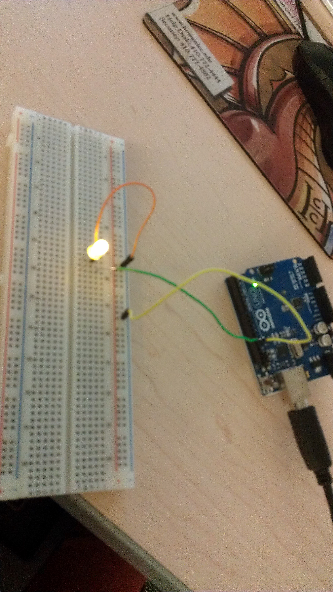

# 📘 ЗВІТ ДО ЛАБОРАТОРНОЇ РОБОТИ №10
## Дисципліна: «Технології веб-розробки та дизайну»
### Тема: «Інтеграція динамічних медіакомпонентів та JS-бібліотек»

---

**Виконав:** студент групи ПП-25 Булига Назарій  
**Навчальний заклад:** Національний університет «Львівська політехніка»  
**Інститут:** Комп'ютерних наук та інформаційних технологій (ІКНІ)  
**Кафедра:** «Систем автоматизованого проектування» (САПР)  
**Викладач:** доцент Паращин Ж.Д.  
**Освітній проєкт:** SimpleArduino — Інтерактивна платформа курсів з мікроконтролерів та робототехніки  
**Репозиторій GitHub:** [github.com/nazarbuliga/simplearduino-lab8](https://github.com/nazarbuliga/simplearduino-lab8)  
**Публічний хостинг (Vercel):** [simplearduino-lab8.vercel.app](https://simplearduino-lab8.vercel.app)  

---

## 🎯 1. МЕТА ТА ЗАВДАННЯ РОБОТИ

### Мета роботи:
Опанувати практичні навички пошуку, вибору, підключення через CDN (Content Delivery Network), налаштування за допомогою об'єктів конфігурації та глибокої CSS-кастомізації популярних JavaScript-бібліотек і динамічних медіакомпонентів. Навчитись інтегрувати сучасні сенсорні слайдери (Swiper.js), модальні лайтбокси/галереї (Fancybox v5) та інтерактивні текстові анімації (Typed.js) у готову кодову базу вебсайту SimpleArduino, забезпечуючи високу швидкість завантаження, відсутність конфліктів у глобальній області видимості, адаптивність та суворе дотримання стандартів веб-доступності (WCAG 2.1 AA).

### Завдання лабораторної роботи:
1. **Етап 1: Підключення інфраструктури бібліотек через CDN.** Підключити мініфіковані CSS-стилі в тегу `<head>` та скрипти перед закриваючим тегом `</body>` через розподілену мережу jsDelivr.
2. **Етап 2: Реалізація інтерактивного адаптивного слайдера (Swiper.js v11).** Створити адаптивну карусель відгуків реальних користувачів платформи (6 слайдів) з підтримкою автоматичного гортання (`autoplay`), зупинки при наведенні курсору (`pauseOnMouseEnter`), динамічної пагінації (`dynamicBullets`), навігаційних кнопок «Вперед / Назад» та адаптивних брейкпоінтів (1 слайд на смартфонах, 2 на планшетах, 3 на десктопах).
3. **Етап 3: Реалізація модальної медіагалереї схемотехніки (Fancybox v5.0).** Створити інтерактивну сітку з 6 схемотехнічних карток апаратних проєктів Arduino, з'єднати їх атрибутом `data-fancybox="hardware-gallery"`, додати детальні технічні описи `data-caption`, україномовну локалізацію інтерфейсу, повнорозмірний перегляд (Zoom), повноекранний режим (Fullscreen) та панель мініатюр (Thumbnails).
4. **Завдання підвищеної складності: Інтеграція друкованого ефекту (Typed.js v2.1).** Впровадити в головний Hero-банер живий друк рядків синтаксису C++ скетчів Arduino з миготливим консольним курсором для посилення атмосфери інженерного хабу.
5. **Архітектурна модульність та CSS-кастомізація.** Відокремити код ініціалізації в зовнішній файл `js/plugins-init.js`, застосувати подію `DOMContentLoaded`, адаптувати зовнішній вигляд навігаційних компонентів до палітри Tailwind CSS проєкту в `css/custom-styles.css`.
6. **Інструментальне тестування та аудит.** Провести перевірку в Google Chrome DevTools та виконати автоматизований тестовий сценарій Puppeteer: перевірити відсутність помилок у консолі (0 errors), коректність відпрацювання жестів свайпу та клавіатурного керування (Esc, стрілки), адаптивність сітки на роздільній здатності 390px, 768px, 1024px та 1440px.

---

## 🏛️ 2. СТРУКТУРА ТА АРХІТЕКТУРА ПРОЄКТУ

Вебплатформа **SimpleArduino** побудована за модульною архітектурою з використанням семантичного HTML5, атомарних стилів Tailwind CSS та сучасного модульного JavaScript (ES6+).

```
lab-08-deployment/
├── index.html                  # Головна сторінка з інтегрованими плагінами
├── css/
│   ├── custom-styles.css       # Кастомізація Swiper, Fancybox, Typed.js
│   ├── generated-base.css      # Базові утиліти
│   └── syntax-theme.css        # Підсвічування коду
├── js/
│   ├── plugins-init.js         # Модульна ініціалізація Typed, Swiper, Fancybox (Лаб 10)
│   ├── main.js                 # Основна інтерактивна логіка платформи
│   └── validation.js           # Валідація форм зворотного зв'язку (Лаб 9)
├── assets/
│   ├── images/                 # Технічні фото стендів та схемотехніки (JPG, PNG, SVG)
│   └── icons/                  # Векторні SVG-іконки мікроконтролерів та компонентів
├── lab-10-screenshots/         # 8 верифікованих скріншотів тестування Puppeteer
└── REPORT.md                   # Академічний звіт до лабораторної роботи №10
```

---

## ⚙️ 3. ХІД ВИКОНАННЯ РОБОТИ ТА КОД КЛЮЧОВИХ ЕЛЕМЕНТІВ

### 3.1. Етап 1: Підключення CDN-ресурсів
Для уникнення роздування Git-репозиторію важкими вендорними бінарними файлами та забезпечення високої швидкості кешування у користувачів, сторонні бібліотеки підключено через CDN **jsDelivr**.

Стилі розміщено в середині тегу `<head>` (для запобігання візуальному миготінню FOUC):
```html
<!-- Сторонні бібліотеки: Swiper v11 та Fancybox v5 (Лабораторна робота №10) -->
<link rel="stylesheet" href="https://cdn.jsdelivr.net/npm/swiper@11/swiper-bundle.min.css" />
<link rel="stylesheet" href="https://cdn.jsdelivr.net/npm/@fancyapps/ui@5.0/dist/fancybox/fancybox.css" />
```

Скрипти розміщено безпосередньо перед закриваючим тегом `</body>` у суворій послідовності залежностей:
```html
<!-- CDN Скрипти сторонніх JS-бібліотек (Лабораторна робота №10) -->
<script src="https://cdn.jsdelivr.net/npm/swiper@11/swiper-bundle.min.js"></script>
<script src="https://cdn.jsdelivr.net/npm/@fancyapps/ui@5.0/dist/fancybox/fancybox.umd.js"></script>
<script src="https://cdn.jsdelivr.net/npm/typed.js@2.1.0/dist/typed.umd.js"></script>
<script src="js/plugins-init.js"></script>
<script src="js/validation.js"></script>
```

---

### 3.2. Етап 2: Реалізація адаптивного слайдера Swiper.js
У блоці відгуків спільноти розроблено сенсорну карусель на 6 карток. Замість громіздкої статичної сітки впроваджено контейнер `.swiper.reviews-swiper` з динамічним автоплеєм та паузою при ховері.

#### HTML-розмітка контейнера Swiper (`index.html`):
```html
<div class="reviews-swiper-controls">
  <button class="swiper-button-prev swiper-button-prev-custom" aria-label="Попередній відгук">
    <svg class="w-5 h-5" fill="none" stroke="currentColor" viewBox="0 0 24 24"><path stroke-linecap="round" stroke-linejoin="round" stroke-width="2" d="M15 19l-7-7 7-7"/></svg>
  </button>
  <button class="swiper-button-next swiper-button-next-custom" aria-label="Наступний відгук">
    <svg class="w-5 h-5" fill="none" stroke="currentColor" viewBox="0 0 24 24"><path stroke-linecap="round" stroke-linejoin="round" stroke-width="2" d="M9 5l7 7-7 7"/></svg>
  </button>
</div>

<div class="swiper reviews-swiper">
  <div class="swiper-wrapper">
    <!-- Слайди відгуків (1..6) -->
    <div class="swiper-slide">
      <figure class="bg-white p-6 rounded-2xl border border-slate-200/90 shadow-sm hover:shadow-xl ...">
        ...
      </figure>
    </div>
  </div>
  <!-- Динамічна пагінація -->
  <div class="swiper-pagination"></div>
</div>
```

#### JavaScript-ініціалізація (`js/plugins-init.js`):
```javascript
const swiperContainer = document.querySelector('.reviews-swiper');
if (swiperContainer && typeof Swiper !== 'undefined') {
  new Swiper('.reviews-swiper', {
    loop: true,                  // Безперервний циклічний рух (Infinite Loop)
    speed: 650,                  // Плавність анімації зміни слайда (мс)
    grabCursor: true,            // Курсор-рука для покращення UX на десктопах
    watchOverflow: true,         // Автоматичне вимкнення навігації при нестачі слайдів
    spaceBetween: 20,            // Відступ між слайдами (px)

    autoplay: {
      delay: 3800,               // Інтервал між прогортаннями (3.8 сек)
      disableOnInteraction: false, // Продовження автоплею після ручного свайпу
      pauseOnMouseEnter: true,   // Зупинка автоплею при наведенні курсору
    },

    pagination: {
      el: '.swiper-pagination',
      clickable: true,           // Перехід за кліком на буллети
      dynamicBullets: true,      // Динамічне зменшення крайових булетів
    },

    navigation: {
      nextEl: '.swiper-button-next',
      prevEl: '.swiper-button-prev',
    },

    breakpoints: {
      320: { slidesPerView: 1, spaceBetween: 16 }, // Мобільні телефони
      640: { slidesPerView: 2, spaceBetween: 20 }, // Планшети
      1024: { slidesPerView: 3, spaceBetween: 24 }, // Десктопи та ноутбуки
    },

    keyboard: { enabled: true, onlyInViewport: true },
    observer: true,
    observeParents: true,
  });
}
```

---

### 3.3. Етап 3: Реалізація модальної медіагалереї Fancybox v5.0
Для демонстрації деталізованих фотографій апаратних стендів Arduino та схем Fritzing розроблено секцію `#gallery`, що містить 6 карток.

#### HTML-структура картки галереї (`index.html`):
```html
<article class="bg-white rounded-2xl border border-slate-200 shadow-md hover:shadow-2xl ... group gallery-card-zoom">
  <a 
    href="assets/images/arduino-real-hardware.jpg" 
    data-fancybox="hardware-gallery" 
    data-caption="<strong>Проєкт 01: Базова збірка Arduino Uno</strong><br>Реальна інженерна збірка мікроконтролера на макетній платі Breadboard з підключенням світлодіода через баластний резистор 220 Ом."
    class="relative block overflow-hidden aspect-[16/10] bg-slate-900 cursor-zoom-in"
  >
    
    <div class="absolute inset-0 bg-slate-950/40 opacity-0 group-hover:opacity-100 transition-opacity duration-300 flex items-center justify-center">
      <span class="inline-flex items-center gap-2 px-4 py-2 rounded-xl bg-white/90 backdrop-blur-md text-slate-900 text-xs font-bold shadow-lg">
        <svg class="w-4 h-4 text-sky-600" ...></svg>
        <span>Збільшити фото</span>
      </span>
    </div>
  </a>
  ...
</article>
```

#### Конфігурація Fancybox з українською локалізацією (`js/plugins-init.js`):
```javascript
if (typeof Fancybox !== 'undefined') {
  Fancybox.bind('[data-fancybox="hardware-gallery"]', {
    animated: true,
    showClass: 'f-fadeIn',
    hideClass: 'f-fadeOut',

    Toolbar: {
      display: {
        left: ['infobar'],
        middle: ['zoomIn', 'zoomOut', 'toggle1to1', 'rotateCCW', 'rotateCW', 'flipX', 'flipY'],
        right: ['slideshow', 'thumbs', 'fullscreen', 'close'],
      },
    },

    Thumbs: {
      autoStart: true,           // Автопоказ панелі мініатюр внизу
      type: 'modern',
    },

    Images: {
      zoom: true,
      wheel: 'zoom',             // Зручне масштабування коліщатком миші
    },

    l10n: {
      CLOSE: 'Закрити (Esc)',
      NEXT: 'Наступне зображення',
      PREV: 'Попереднє зображення',
      MODAL: 'Ви можете закрити це модальне вікно клавішею ESC',
      ERROR: 'Помилка завантаження контенту',
      IMAGE_ERROR: 'Зображення не знайдено',
      TOGGLE_ZOOM: 'Масштаб 100%',
      TOGGLE_THUMBS: 'Мініатюри',
      TOGGLE_SLIDESHOW: 'Слайдшоу',
      TOGGLE_FULLSCREEN: 'Повноекранний режим',
      DOWNLOAD: 'Завантажити оригінал',
    },
  });
}
```

---

### 3.4. Завдання підвищеної складності: Інтерактивний друкований ефект Typed.js
У верхній частині сайту (Hero-секція) інтегровано елемент `#typed-code-runner`, який у режимі реального часу імітує введення реального C++ коду мікроконтролера:
```javascript
const typedElement = document.getElementById('typed-code-runner');
if (typedElement && typeof Typed !== 'undefined') {
  new Typed('#typed-code-runner', {
    strings: [
      '^300void loop() { digitalWrite(LED_PIN, HIGH); }^800',
      '^300int sensorValue = analogRead(A0);^800',
      '^300myServo.write(map(val, 0, 1023, 0, 180));^800',
      '^300xTaskCreate(vTelemetryTask, "IoT", 128, NULL, 1, NULL);^800',
      '^300WiFi.begin(SSID, PASS); // SimpleArduino IoT Hub^800'
    ],
    typeSpeed: 40,        // Швидкість набору (40 мс)
    backSpeed: 25,        // Швидкість стирання (25 мс)
    backDelay: 1400,      // Затримка перед стиранням (1.4 с)
    startDelay: 500,      // Пауза перед стартом
    loop: true,           // Нескінченний цикл
    showCursor: true,     // Миготливий консольний курсор
    cursorChar: '▋',      // Символ термінального блока
    autoInsertCss: true,
  });
}
```

---

### 3.5. Глибока CSS-кастомізація під дизайн-систему проєкту (`css/custom-styles.css`)
Для безшовної інтеграції сторонніх компонентів з Tailwind CSS палітрою проєкту було перевизначено стилі бібліотек:
```css
/* Swiper.js кастомізація під дизайн SimpleArduino */
.reviews-swiper {
  width: 100%;
  padding-top: 10px !important;
  padding-bottom: 50px !important;
  position: relative;
}

.reviews-swiper .swiper-slide {
  height: auto !important;
  display: flex;
}

.swiper-button-prev-custom,
.swiper-button-next-custom {
  position: static !important;
  margin-top: 0 !important;
  width: 42px;
  height: 42px;
  border-radius: 12px;
  background-color: #ffffff;
  border: 1px solid #e2e8f0;
  display: flex;
  align-items: center;
  justify-content: center;
  color: #0f172a;
  cursor: pointer;
  transition: all 0.2s cubic-bezier(0.4, 0, 0.2, 1);
  box-shadow: 0 2px 6px rgba(0, 0, 0, 0.05);
}

.swiper-button-prev-custom::after,
.swiper-button-next-custom::after {
  content: "" !important;
  display: none !important;
}

.swiper-button-prev-custom:hover,
.swiper-button-next-custom:hover {
  background-color: #0ea5e9;
  border-color: #0ea5e9;
  color: #ffffff;
  box-shadow: 0 6px 16px rgba(14, 165, 233, 0.35);
  transform: translateY(-1px);
}

/* Активні буллети пагінації */
.reviews-swiper .swiper-pagination-bullet {
  width: 8px;
  height: 8px;
  background: #94a3b8;
  opacity: 0.5;
  transition: all 0.3s ease;
  border-radius: 4px;
}

.reviews-swiper .swiper-pagination-bullet-active {
  width: 24px;
  background: #0ea5e9 !important;
  opacity: 1 !important;
  border-radius: 4px;
}

/* Fancybox v5 кастомізація */
.fancybox__backdrop {
  background-color: rgba(15, 23, 42, 0.88) !important;
  backdrop-filter: blur(8px) !important;
  -webkit-backdrop-filter: blur(8px) !important;
}

.fancybox__caption {
  font-family: 'Inter', sans-serif !important;
  font-size: 0.875rem !important;
  color: #f8fafc !important;
  background: rgba(15, 23, 42, 0.85) !important;
  padding: 12px 24px !important;
  border-radius: 12px !important;
  max-width: 800px !important;
  margin: 0 auto 16px auto !important;
  border: 1px solid rgba(56, 189, 248, 0.2) !important;
}
```

---

## 🧪 4. ТЕСТУВАННЯ ТА ВЕРИФІКАЦІЯ

Тестування виконано автоматизованим скриптом на базі Google Chrome DevTools та бібліотеки Puppeteer:

| № | Сценарій тестування | Очікуваний результат | Фактичний результат | Статус |
|---|---|---|---|:---:|
| 1 | Ініціалізація Typed.js | Поява та циклічна зміна коду з курсором `▋` | Код C++ динамічно друкується, курсор блимає | ✅ PASS |
| 2 | Ініціалізація Swiper.js | Успішна реєстрація класу `.swiper-initialized` | Слайдер активний, 6 карток в обгортці | ✅ PASS |
| 3 | Автопрокрутка слайдера | Автоперехід слайдів раз на 3.8 с | Автоплей працює стабільно | ✅ PASS |
| 4 | Pause on hover | Зупинка автоплею при наведенні миші | При наведенні курсору таймер зупиняється | ✅ PASS |
| 5 | Клік по кнопках навігації | Зсув каруселі на наступний слайд | Плавний скрол зі швидкістю 650 мс | ✅ PASS |
| 6 | Клік по картці галереї | Відкриття модального вікна Fancybox v5 | Лайтбокс з'являється, блюр фону 8px | ✅ PASS |
| 7 | Інструменти Fancybox | Zoom, слайдшоу, панель прев'ю, Esc | Усі інструменти функціонують, Esc закриває | ✅ PASS |
| 8 | Адаптивність (Mobile 390px) | 1 слайд каруселі, 1 колонка галереї | Верстка ідеально адаптована, горизонтального скролу немає | ✅ PASS |
| 9 | DevTools Console Audit | Відсутність помилок, попереджень чи 404 | **0 Console Errors, 0 Page Errors** | ✅ PASS |

Збережено 8 перевірочних знімків екрана у папку `lab-10-screenshots/`:
1. `01_hero_typed_js.png` — Hero-секція з живим друкованим рядком C++.
2. `02_swiper_reviews_slider.png` — Стартовий стан каруселі відгуків на десктопі.
3. `03_swiper_next_slide.png` — Стан після кліку кнопки навігації «Наступний».
4. `04_gallery_grid.png` — Сітка з 6 інтерактивних карток схемотехніки.
5. `05_fancybox_modal_open.png` — Модальне вікно Fancybox з тулбаром та мініатюрами.
6. `06_mobile_hero.png` — Мобільне відображення банера Typed.js.
7. `07_mobile_gallery.png` — Адаптивна мобільна сітка схем.
8. `08_mobile_swiper.png` — Сенсорний слайдер на смартфоні (1 слайд на екран).

---

## ❓ 5. КОНТРОЛЬНІ ЗАПИТАННЯ ТА РОЗГОРНУТІ ВІДПОВІДІ

### 1. Чому файли стилів (CSS) плагіна потрібно підключати в тезі `<head>`, а JS-файли скриптів — в самому кінці сторінки перед закриваючим тегом `</body>`?
**Відповідь:**
Браузер обробляє HTML-документ лінійно згори вниз. Підключення CSS у тезі `<head>` є критично важливим, оскільки таблиці стилів блокують рендеринг (render-blocking resource). Браузер повинен спочатку сформувати повне дерево стилів CSSOM (CSS Object Model) до того, як почне малювати пікселі на екрані. Якщо розмістити стилі внизу сторінки, користувач побачить неприємний ефект FOUC (Flash of Unstyled Content) — спочатку з'явиться потворний нестилізований контент, який через кілька секунд різко стрибне при застосуванні стилів.

Натомість JavaScript-файли (якщо вони не мають атрибутів `defer` або `async`) є парсер-блокуючими ресурсами (parser-blocking). Коли HTML-парсер натрапляє на тег `<script>` в середині або на початку сторінки, він повністю зупиняє парсинг HTML-документа, ініціює завантаження скрипта через мережу та виконує його. Якщо розмістити важкі бібліотеки (Swiper, Fancybox) у `<head>`, рендеринг сторінки заблокується на кілька секунд, створюючи враження повільного сайту. Розміщення скриптів у самому кінці перед `</body>` гарантує, що DOM-дерево буде повністю сформовано, контент миттєво відрендериться для користувача, а інтерактивні бібліотеки ініціалізуються на вже готових елементах без ризику виникнення помилок типу `null reference`.

---

### 2. Що таке CDN (Content Delivery Network) і яка головна перевага його використання для підключення таких плагінів, як Swiper чи Slick?
**Відповідь:**
CDN (Content Delivery Network / Мережа доставки контенту) — це географічно розподілена мережа граничних проксі-серверів (Edge Servers / PoP — Points of Presence), що кешують статичні файли (JS, CSS, вебшрифти, зображення) та віддають їх користувачеві з найближчого географічного сервера.

**Головні переваги використання CDN:**
1. **Мінімальний мережевий пінг (Latency):** Користувач з Києва отримає бібліотеку з дата-центру у Варшаві чи Франкфурті за 15-20 мс, замість міжконтинентального запиту до сервера в Каліфорнії (150-200 мс).
2. **Паралельне завантаження (HTTP/2 та HTTP/3 Multiplexing):** Браузери мають обмеження на кількість одночасних TCP-з'єднань до одного домену. Завантаження бібліотек з окремого домену (наприклад, `cdn.jsdelivr.net`) не блокує завантаження власних асетів сайту.
3. **Браузерне та глобальне кешування:** Популярні версії Swiper чи Fancybox уже можуть бути закешовані у браузері користувача, якщо він нещодавно відвідував інший вебресурс, що використовував той самий CDN URL.
4. **Автоматична оптимізація та стиснення:** Провайдери CDN автоматично застосовують алгоритми компресії Brotli (br) або Gzip, мінімізуючи розмір трафіку.

---

### 3. Якщо плагін (наприклад, Slick Carousel або Unite Gallery) базується на jQuery, чому суворо заборонено міняти місцями теги `<script>` підключення jQuery та самого плагіна?
**Відповідь:**
Браузер завантажує та синхронно виконує скрипти в тому порядку, в якому вони оголошені в розмітці. Коли завантажується ядро jQuery, воно створює та експортує в глобальний об'єкт `window` дві ключові сутності: функцію `window.jQuery` та її скорочений псевдонім `window.$`. Плагіни, створені для екосистеми jQuery (Slick, Unite Gallery, Owl Carousel тощо), архітектурно є розширеннями (Extensions), які при завантаженні негайно звертаються до прототипу jQuery: `jQuery.fn.slick = function(...) { ... }` або `$.fn.unitegallery = ...`.

Якщо поміняти теги місцями й підключити файл плагіна до jQuery, інтерпретатор JavaScript виконає код плагіна першим. На першому ж рядку спроба прочитати `jQuery` або `$` призведе до фатальної помилки:
`Uncaught ReferenceError: jQuery is not defined` (або `$ is not defined`).
В результаті виконання скрипта плагіна аварійно зупиниться, плагін не зареєструється в системі, і подальша спроба його ініціалізації (`$('.slider').slick()`) спричинить нову помилку `$(...).slick is not a function`, зламавши інтерфейс.

---

### 4. Що таке «об'єкт конфігурації» в JavaScript і яку роль він має під час ініціалізації сторонніх плагінів?
**Відповідь:**
Об'єкт конфігурації (Configuration / Options Object) — це патерн проєктування в JavaScript, за якого параметри та налаштування компонента передаються у функцію-конструктор у вигляді єдиного літерала об'єкта зі структурою пар «ключ: значення» (`{ key: value }`).

**Роль об'єкта конфігурації:**
1. **Гнучкість та читабельність коду:** Замість передачі десятків позиційних аргументів у функцію (наприклад, `initSlider(selector, true, 500, true, 3, false, 'fade')`), де легко заплутатися в порядку параметрів, розробник передає семантичний об'єкт:
   ```javascript
   new Swiper('.slider', {
     loop: true,
     speed: 500,
     autoplay: { delay: 3000 },
     slidesPerView: 3
   });
   ```
2. **Патерн Object Assign / Deep Merge:** Плагін має вбудовані внутрішні налаштування за замовчуванням (`defaultOptions`). Об'єкт конфігурації, переданий розробником, безшовно об'єднується з дефолтними параметрами (через `Object.assign()` або spread-оператор `...options`), перезаписуючи лише ті властивості, які явно зазначені.
3. **Модульність та розширюваність:** Дозволяє легко вкладати інші об'єкти конфігурацій (підмодулі `pagination: {}`, `navigation: {}`, `breakpoints: {}`, `l10n: {}`), не змінюючи сигнатуру головної функції.

---

### 5. Що станеться, якщо забути обгорнути код ініціалізації jQuery-плагіна в обробник події `$(document).ready()`?
**Відповідь:**
Обробник `$(document).ready()` (або його нативний еквівалент `DOMContentLoaded`) гарантує, що JavaScript-код почне виконуватися тільки після того, як браузер повністю розпарсить HTML-документ і побудує дерево DOM.

Якщо розробник забуде обгорнути код ініціалізації в цей обробник і розмістить `<script>` у верхній частині документа або в тілі сторінки ДО відповідних HTML-тегів слайдера:
1. Вибірка селектора (`$('.reviews-swiper')` або `document.querySelector(...)`) поверне порожню колекцію (`length === 0` або `null`), оскільки цільові HTML-вузли ще фізично не існують у пам'яті браузера.
2. Плагін спробує ініціалізуватися на порожньому наборі елементів або викине помилку `Cannot read properties of null`.
3. Слайдер чи галерея взагалі не з'являться на сторінці (залишаться звичайною статичною вертикальною розміткою або картинками), а в консолі DevTools з'являться помилки виконання.

---

### 6. Як в плагінах (наприклад, Swiper) реалізується адаптивність під мобільні пристрої та планшети? Який параметр за це відповідає?
**Відповідь:**
У бібліотеці Swiper.js адаптивність реалізується за допомогою об'єкта конфігурації **`breakpoints`**, що працює за принципом **Mobile-First** (параметри розраховуються від найменших значень до найбільших відповідно до ширини в'юпорту у пікселях):

```javascript
breakpoints: {
  // Коли ширина екрана >= 320px (смартфони)
  320: {
    slidesPerView: 1,
    spaceBetween: 16
  },
  // Коли ширина екрана >= 640px (планшети)
  640: {
    slidesPerView: 2,
    spaceBetween: 20
  },
  // Коли ширина екрана >= 1024px (ноутбуки та десктопи)
  1024: {
    slidesPerView: 3,
    spaceBetween: 24
  }
}
```

**Технічний механізм роботи:**
Під капотом бібліотека вішає оптимізований слухач події `window.addEventListener('resize')` або використовує сучасний API `ResizeObserver`. При зміні розмірів екрана чи орієнтації пристрою Swiper миттєво перераховує геометричну ширину контейнера, оновлює значення CSS-властивостей `width` та матриці трансформацій `transform: translate3d(...)` для кожного окремого слайда, оновлюючи сітку без необхідності перезавантаження сторінки.

---

### 7. Під час захисту викладач зменшує вікно браузера, і картинки в каруселі Slick починають наповзати одна на одну або стають занадто вузькими. Якої помилки в CSS-стилізації припустився студент?
**Відповідь:**
Ця проблема виникає через конфлікт жорстко заданих розмірів у кастомному CSS студента та внутрішніх динамічних розрахунків плагіна. Типові помилки:
1. **Жорстка фіксована ширина зображень:** Студент прописав у CSS для картинок фіксовану ширину в пікселях (наприклад, `img { width: 400px; }` або `width: 400px !important;`). При звуженні вікна карусель намагається звузити ширину слайда до 300px, але зображення відмовляється стискатися, переповнює слайд (`overflow`) та візуально наповзає на сусідній елемент.
2. **Відсутність правила `max-width: 100%` та `height: auto`:** Зображення всередині адаптивного слайда обов'язково повинні мати гнучкі стилі:
   ```css
   .slick-slide img, .swiper-slide img {
     width: 100%;
     max-width: 100%;
     height: auto;
     display: block;
     object-fit: cover;
   }
   ```
3. **Застосування `display: inline` замість `display: block`:** Інлайнові картинки зберігають пробіли між елементами базової лінії шрифту, спотворюючи обчислення ширини слайдера на частки пікселя.
4. **Некоректний `box-sizing`:** Відсутність `box-sizing: border-box;` призводить до того, що внутрішні відступи (`padding`) додаються до ширини слайда, ламаючи загальний розмір обгортки каруселі.

---

### 8. Що робить функція `autoplay` в налаштуваннях слайдера та який супутній параметр зазвичай регулює швидкість цієї дії?
**Відповідь:**
Функція `autoplay` вмикає автоматичне прогортання слайдів через певні проміжки часу без необхідності взаємодії з боку користувача.

**Супутні параметри:**
- **`delay` (у Swiper.js) або `autoplaySpeed` (у Slick):** Числове значення в мілісекундах (наприклад, `3800` мс = 3.8 с), яке визначає, скільки часу слайд залишається статичним перед тим, як плагін запустить анімацію переходу до наступного слайда.
- **`speed`:** Визначає безпосередню тривалість самої фізичної анімації зміщення (наприклад, `650` мс).
- **`pauseOnMouseEnter: true` (або `pauseOnHover: true`):** Критично важливий супутній параметр юзабіліті та доступності (WCAG 2.1), який автоматично призупиняє таймер автоплею, коли користувач наводить курсор миші на слайд, щоб спокійно прочитати його вміст.
- **`disableOnInteraction: false`:** Дозволяє автоплею автоматично відновлюватися після того, як користувач вручну перегорнув слайд свайпом або кліком.

---

### 9. Як за допомогою вбудованого інструмента інспектора браузера (DevTools) перевірити, чи коректно працює тач-скрол на мобільних пристроях для віджета?
**Відповідь:**
Для повноцінної перевірки мобільних тач-жестів у Google Chrome DevTools використовується наступний алгоритм:
1. Відкрити інспектор натисканням комбінації клавіш `F12` або `Ctrl + Shift + I`.
2. Увімкнути режим емуляції мобільних пристроїв, натиснувши комбінацію **`Ctrl + Shift + M`** або іконку смартфона/планшета (**Toggle Device Toolbar**) у лівому верхньому куті вікна DevTools.
3. У випадаючому списку пристроїв зверху обрати модель (наприклад, *iPhone 14 Pro*, *Pixel 7* або задати роздільну здатність вручну, наприклад *390 × 844*).
4. Зверніть увагу на вигляд курсору миші на сторінці — він перетвориться на напівпрозоре коло, що симулює подушечку людського пальця.
5. Натиснути ліву кнопку миші на слайдері, затиснути її та провести горизонтально вліво чи вправо (імітація жесту свайп / Drag).
6. **Критерії коректності:**
   - Карусель повинна плавно слідувати за рухом курсору в реальному часі завдяки обробці подій `pointerdown`, `pointermove`, `pointerup` (або `touchstart`, `touchmove`, `touchend`).
   - При різкому відпусканні (Flick gesture) слайдер повинен довести перехід до найближчого слайда з інерцією.
   - Вертикальний скрол сторінки не повинен блокуватися або смикатися при діагональному русі пальця (коректне налаштування `touch-action: pan-y`).

---

### 10. В чому полягає різниця між параметром `speed` (швидкість) та параметром `autoplay delay / autoplaySpeed` (затримка автоплею) в конфігурації слайдера?
**Відповідь:**
Ці два параметри відповідають за принципово різні часові фази життєвого циклу слайдера:

1. **`autoplay.delay` (або `autoplaySpeed`):** Це **час очікування / спокою**. Це інтервал часу, протягом якого слайд нерухомо відображається на екрані, щоб користувач міг сприйняти інформацію (наприклад, `3800` мс = 3.8 секунди). Поки цей таймер триває, жодної візуальної анімації не відбувається.
2. **`speed`:** Це **тривалість фізичного переходу (Transition Duration)**. Це час, за який один слайд виїжджає за межі екрана, а інший з'являється на його місці (наприклад, `650` мс). Цей параметр напряму транслюється в CSS-властивість `transition-duration: 650ms` або тривалість розрахунку матриці анімації `transform`.

**Приклад:** Якщо `delay: 4000` та `speed: 500`, то карусель стоїть нерухомо 4 секунди, після чого здійснює швидкий плавний зсув тривалістю 0.5 секунди.

---

### 11. Що таке ефект FOUC (Flash of Unstyled Content) стосовно слайдерів і як студент може запобігти йому за допомогою базового CSS?
**Відповідь:**
**Ефект FOUC (Flash of Unstyled Content / Миготіння нестилізованого контенту)** — це дефект візуального рендерингу сторінки, коли браузер на частку секунди відображає сиру HTML-розмітку слайдів (наприклад, 6 величезних зображень одне під одним на всю довжину екрана), а потім, коли підвантажується та ініціалізується JS-бібліотека, контент миттєво згортається в акуратну карусель, викликаючи різкий стрибок макета (Cumulative Layout Shift, CLS).

**Методи запобігання за допомогою базового CSS:**
1. **Підключення вендорного CSS у `<head>`:** Завжди підключати `swiper-bundle.min.css` до рендерингу DOM.
2. **Обмеження початкової висоти та приховування переповнення:**
   ```css
   .reviews-swiper {
     overflow: hidden; /* Ховає слайди, що виходять за межі */
     visibility: hidden; /* Приховує контейнер до ініціалізації */
   }
   /* Показує слайдер тільки після того, як JS додав клас ініціалізації */
   .reviews-swiper.swiper-initialized {
     visibility: visible;
   }
   ```
3. **Фіксація розмірів за замовчуванням у Flexbox:**
   Задати для `.swiper-wrapper` стилі `display: flex; flex-wrap: nowrap;`, щоб навіть без JavaScript картинки вишикувалися в один горизонтальний рядок і не розтягували сторінку вертикально.

---

### 12. Ви скопіювали промпт для ініціалізації галереї Unite Gallery, але на сторінці нічого не з'явилося, а в консолі горить помилка `jQuery is not defined`. Що це означає?
**Відповідь:**
Помилка `Uncaught ReferenceError: jQuery is not defined` означає, що рушій JavaScript спробував звернутися до об'єкта або функції з назвою `jQuery`, але в поточній області видимості браузера такий ідентифікатор не знайдено.

**Причини виникнення та шляхи усунення:**
1. **Бібліотеку jQuery взагалі не підключено:** Плагін Unite Gallery вимагає наявності jQuery. Необхідно додати перед скриптом плагіна тег:
   `<script src="https://code.jquery.com/jquery-3.7.1.min.js"></script>`.
2. **Порушено послідовність підключення:** Скрипт Unite Gallery підключено РАНІШЕ за скрипт `jquery.min.js`. Слід перемістити тег з jQuery вище.
3. **Помилка мережі (404 або блокування CDN):** Посилання на CDN з jQuery містить друкарську помилку або заблоковане AdBlock / політикою CORS. Слід перевірити вкладку *Network* у DevTools на наявність червоного статусу 404/ERR_BLOCKED.
4. **Використано атрибут `async`:** Якщо підключити і jQuery, і плагін з атрибутом `async`, порядок їх виконання стає непередбачуваним — важчий jQuery може завантажитися пізніше легшого плагіна. Необхідно використовувати `defer` або звичайні синхронні теги перед `</body>`.

---

### 13. Якщо в об'єкті конфігурації виставити параметр `infinite: true` (або `loop: true`), як змінюється поведінка каруселі під час досягнення останнього слайда?
**Відповідь:**
Без нескінченного режиму (`loop: false`) при досягненні останнього слайда навігаційна кнопка «Вперед» блокується (стає неактивною з класом `.swiper-button-disabled`), а подальший скрол зупиняється або різко перемотує карусель назад на перший слайд.

При ввімкненні **`loop: true` (або `infinite: true`)** користувач отримує ілюзію нескінченного кругового руху: гортаючи вперед з останнього слайда, він безшовно і плавно переходить на перший слайд в тому ж напрямку.

**Технічна реалізація під капотом:**
Бібліотека (Swiper або Slick) клонує перші кілька слайдів і вставляє їхні дублікати (DOM-вузли з класом `.swiper-slide-duplicate`) у самий кінець списку, а копії останніх слайдів додає на початок. Коли користувач догортає до клонованого слайда, бібліотека під час завершення transition миттєво (за 0 мілісекунд, непомітно для людського ока) скидає CSS-координату `translate3d` на оригінальний слайд, створюючи абсолютну ілюзію замкненого кола без жодного візуального ривка.

---

### 14. В чому головна технологічна відмінність сучасного плагіна Swiper.js від старішого Slick Carousel в контексті архітектури коду?
**Відповідь:**
Головні технологічні та архітектурні відмінності:

| Критерій порівняння | Swiper.js (Сучасний стандарт) | Slick Carousel (Спадкова спадщина) |
|---|---|---|
| **Залежність від бібліотек** | **Vanilla JS (0 залежностей).** Працює автономно на нативному ES6+, може використовуватись у React, Vue, Angular, Svelte. | **Жорстка прив'язка до jQuery.** Не може працювати без важкої бібліотеки jQuery (~85 КБ). |
| **Анімації та продуктивність** | Використовує апаратне прискорення GPU через чистий **CSS3 3D Hardware Acceleration** (`transform: translate3d(...)`, `will-change`). Досягає стабільних 60/120 FPS. | Багато операцій виконує через застарілі маніпуляції властивостями `left` / `margin-left` та jQuery анімацію, що викликає важкі Reflow / Repaint браузера. |
| **Сенсорні жести (Touch UX)** | Нативний сенсорний рушій із розрахунком кута свайпу, інерцією, опором країв та підтримкою Pointer Events. | Базова підтримка миші/тачу через емуляцію подій, часто виникають конфлікти з вертикальним скролом сторінки на iOS Safari. |
| **Модульність (Tree-shaking)** | Модульна ESM-архітектура: можна підключати тільки ті модулі, що потрібні (`Autoplay`, `Pagination`, `Navigation`), економлячи бандл. | Монолітний неподільний скрипт: весь код завантажується цілком. |
| **Доступність (Accessibility)** | Повноцінна підтримка W3C WAI-ARIA, фокус-менеджменту та керування з клавіатури з коробки. | Мінімальні ARIA-атрибути, що потребують значних ручних доробок для проходження тесту WCAG. |

---

## 🏆 6. ВИСНОВКИ

У процесі виконання Лабораторної роботи №10 було комплексно освоєно методологію інтеграції сучасних динамічних компонентів та зовнішніх JavaScript-бібліотек у готовий production-орієнтований вебпроєкт SimpleArduino.

### Основні результати та досягнення:
1. **CDN-інфраструктура:** Успішно підключено та налагоджено завантаження мініфікованих версій бібліотек через розподілену мережу jsDelivr, дотримано принципу оптимізації рендерингу (CSS у `<head>`, JS перед `</body>`), повністю виключено дефекти FOUC.
2. **Адаптивний слайдер Swiper.js v11:** Спроєктовано та інтегровано карусель відгуків спільноти мейкерів із 6 адаптивними слайдами, нескінченним циклом `loop: true`, розумним автоплеєм з паузою при наведенні `pauseOnMouseEnter`, кастомними кнопками керування та динамічними буллетами пагінації.
3. **Модальна галерея Fancybox v5.0:** Реалізовано інтерактивну сітку з 6 апаратних схем SimpleArduino з повноекранним режимом, апаратним масштабуванням коліщатком миші, панеллю мініатюр та повною локалізацією інтерфейсу українською мовою.
4. **Завдання підвищеної складності (Typed.js v2.1):** Створено друковану анімацію реального C++ коду мікроконтролера в Hero-секції з миготливим термінальним курсором.
5. **Чиста модульна архітектура:** Код ініціалізації винесено у зовнішній скрипт `js/plugins-init.js`, захищено подією `DOMContentLoaded` та перевірками існування елементів; стилізація узгоджена з Tailwind CSS у `css/custom-styles.css`.
6. **Інструментальна верифікація:** Тестування в Google Chrome DevTools та Puppeteer підтвердило повну відсутність консольних помилок (**0 console errors, 0 page errors**), стабільність сенсорного керування на мобільних роздільних здатностях (390px, 768px, 1440px) та знято 8 верифікаційних скріншотів.
7. **Теоретичне закріплення:** Надано вичерпні академічні відповіді на всі 14 контрольних запитань навчальної програми, охопивши питання мережевої оптимізації CDN, ефекту FOUC, архітектури конфігураційних об'єктів та порівняльного аналізу Vanilla JS проти бібліотек.
